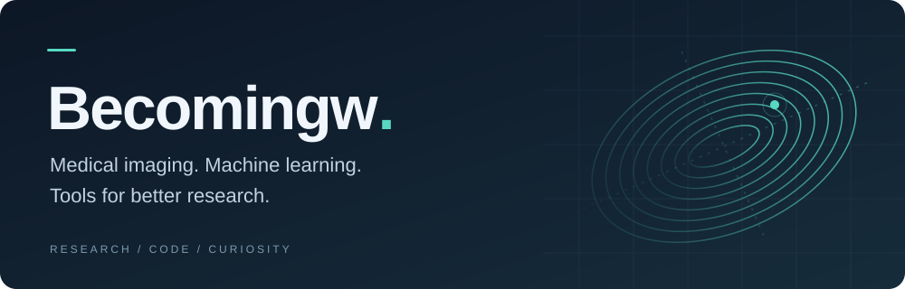
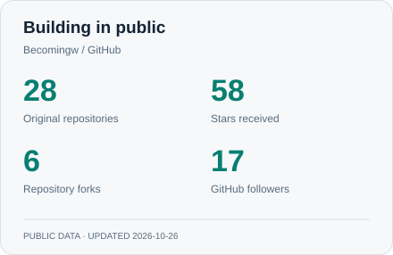
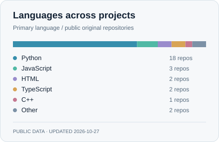

  

  <b>From medical images to useful intelligence.</b> 
  医学影像 · 人工智能 · 开源工具

  <a href="#research">Research</a> &nbsp; / &nbsp;
  <a href="#projects">Projects</a> &nbsp; / &nbsp;
  <a href="#toolkit">Toolkit</a> &nbsp; / &nbsp;
  <a href="#activity">Activity</a>

  
  

I'm **Becomingw**, a PhD student working at the intersection of **medical imaging and AI**. I explore how generative models can improve images, how language models can help make sense of radiology reports, and how better software can make research easier to do.

Alongside research, I build tools for reading papers, reviewing manuscripts, and working across remote machines. I also write about medical imaging and AI on WeChat.

## Research & curiosity

**01 / Better images**  
Generative image enhancement, cross-modality synthesis, and super-resolution — with an interest in diffusion models and anatomically meaningful reconstruction.

**02 / Language in radiology**  
Large language models for report understanding, structured classification, and medical research workflows.

**03 / Tools that support the work**  
Literature discovery, manuscript review, reproducible experiments, and agent-assisted computing.

## Selected projects

A selection of research code and tools I build around the research process.

<table>
<tr>
<td width="50%" valign="top">
<h3><a href="https://github.com/Becomingw/RescueCTA">RescueCTA</a></h3>

MEDICAL IMAGING · GENERATIVE ENHANCEMENT

Generative enhancement of suboptimally opacified cerebral CTA for large-vessel occlusion detection.

<a href="https://github.com/Becomingw/RescueCTA">Explore the research →</a>

</td>
<td width="50%" valign="top">
<h3><a href="https://github.com/Becomingw/MF-BBDM">MF-BBDM</a></h3>

DIFFUSION MODELS · MRI

Multi-view fusion-guided Brownian bridge diffusion for ultra-low-field MRI enhancement.

<a href="https://github.com/Becomingw/MF-BBDM">Explore the research →</a>

</td>
</tr>
<tr>
<td width="50%" valign="top">
<h3><a href="https://github.com/Becomingw/CGP-Plaque">CGP-Plaque</a></h3>

RADIOLOGY · LANGUAGE MODELS

Large language model assistance for report-based carotid plaque AHA classification.

<a href="https://github.com/Becomingw/CGP-Plaque">Explore the research →</a>

</td>
<td width="50%" valign="top">
<h3><a href="https://github.com/Becomingw/Margin">Margin · 页边</a></h3>

WRITING · LOCAL-FIRST WORKSPACE

A Markdown and LaTeX review workspace to read, annotate, revise, and retain the full history.

<a href="https://github.com/Becomingw/Margin">Explore the workspace →</a>

</td>
</tr>
<tr>
<td width="50%" valign="top">
<h3><a href="https://github.com/Becomingw/dsh-orca">Orca</a></h3>

AGENT TOOLING · REMOTE COMPUTE

A remote fleet plugin for DeepSeek Harness: SSH tools, GPU status, background jobs, and a native control panel.

<a href="https://github.com/Becomingw/dsh-orca">Explore the plugin →</a>

</td>
<td width="50%" valign="top">
<h3><a href="https://github.com/Becomingw/MedspiderPlus">MedspiderPlus</a></h3>

LITERATURE · RESEARCH WORKFLOW

A desktop PubMed search tool built with PyQt5 and ChatGPT to support literature discovery.

<a href="https://github.com/Becomingw/MedspiderPlus">Explore the tool →</a>

</td>
</tr>
</table>

<b>More from the workbench</b>

- [Arca](https://github.com/Becomingw/Arca) — a self-hosted AI gateway based on Aether, with protocol conversion, routing, and quota management.
- [rmount-ctx](https://github.com/Becomingw/rmount-ctx) — work across remote servers from one agent environment.
- [Autossh Manager](https://github.com/Becomingw/Autossh_Manager) — manage reverse SSH tunnels through a web interface.
- [Bone LLM](https://github.com/Becomingw/Bone_LLM_code) — research code for LLM-assisted bone metastasis CT report analysis.
- [PCD-SSM](https://github.com/Becomingw/PCD-SSM) — point-cloud statistical shape models for vascular modeling.

## Everyday toolkit

  <a href="https://skillicons.dev">
    <picture>
      <source media="(prefers-color-scheme: dark)" srcset="https://skillicons.dev/icons?i=python%2Cpytorch%2Ccpp%2Clinux%2Cjs%2Cts%2Cgit%2Cdocker&amp;theme=dark&amp;perline=8" />
      
    </picture>
  </a>

**Research:** Python · PyTorch · generative models · medical image analysis  
**Building:** JavaScript / TypeScript · Linux · Git · remote computing

## Open source, in progress

  <picture>
    <source media="(prefers-color-scheme: dark)" srcset="assets/stats-dark.svg" />
    
  </picture>
  <picture>
    <source media="(prefers-color-scheme: dark)" srcset="assets/languages-dark.svg" />
    
  </picture>

  

Snapshot cards refresh daily through GitHub Actions. Repository metrics exclude forks and private repositories; language counts describe repositories, not skill level. Contribution streaks are provided by <a href="https://github.com/DenverCoder1/github-readme-streak-stats">GitHub Readme Streak Stats</a>.

---

  <b>Stay curious. Keep building.</b> 
  探索医学影像，也探索更好的研究方式。

  <a href="https://github.com/Becomingw?tab=repositories">Browse my repositories</a> ·
  <a href="https://github.com/Becomingw?tab=stars">See what I'm exploring</a>

